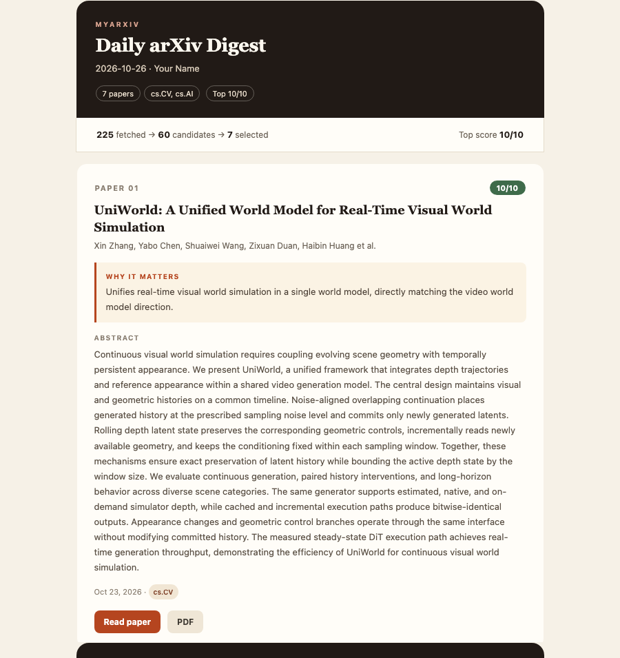

# MyArxiv

**A personalized arXiv digest that reads the firehose for you.**

MyArxiv fetches the latest papers from the arXiv categories you care about, filters them with a phrase-aware keyword pass, scores the survivors with an LLM against your research interests, and emails you a clean daily digest. It runs locally in one command — no server required.



[HTML demo](demo/report.html) · [plain-text demo](demo/report.txt) · [TUI transcript](demo/tui.txt)

## Why

arXiv publishes hundreds of papers a day. Keyword search is noisy, and reading every abstract is not an option. MyArxiv combines cheap deterministic filtering with an LLM relevance score, so you only see the handful of papers that match the direction you are actually working on.

## Features

- **Daily arXiv fetch** — pulls recent papers from your categories (`cs.CV`, `cs.AI`, `cs.LG`, …) with a same-day local cache.
- **Phrase-aware pre-filter** — a free, deterministic step that handles stopwords, plurals and word boundaries, drops excluded topics, and ranks candidates by keyword coverage before any LLM call.
- **LLM deep scoring** — scores each abstract 0–10 at temperature `0.0` with calibration anchors; keeps papers above your threshold and caps the digest at your daily limit.
- **Polished email** — responsive HTML with score badges, “Why it matters” callouts, PDF buttons, a plain-text alternative, and a dark-mode stylesheet.
- **Rich TUI + scriptable CLI** — `prompt-toolkit`/`rich` terminal with completion, history, preview tables, and reviewable AI diffs; every change is also available as a one-line command.
- **Preview and dry run** — test interest changes against cached papers without sending email or marking anything as seen.
- **Keyword weights** — mark a term as core (`3`) or related (`2`) instead of treating every keyword equally.
- **Secrets stay out of the repo** — API keys and SMTP passwords come from `.env`; `config.yaml` is gitignored.

## How it works

```text
fetch_daily_papers()      arXiv API + .cache/ (same-day reuse)
        │
        ▼
seen_papers.json          skip papers already delivered
        │
        ▼
keyword_prefilter()       phrase/coverage scoring, strict exclude → top 60
        │
        ▼
chat_final_score()        LLM batches, temperature 0.0, score 0–10
        │                 keep score ≥ min_relevance_score, top max_papers
        ▼
build_report()            responsive HTML + plain-text alternative
        │
        ▼
send_email()              SMTP (Gmail by default)
        │ success only
        ▼
save_seen_ids()           mark delivered papers as seen
        │
        ▼
last_run.json             fetch/filter/select stats + per-keyword hits
```

Only delivered papers are marked seen. A failed email leaves the queue untouched so the next run retries.

## Quick start

### 1. Clone and install

```bash
git clone https://github.com/<your-username>/myarxiv.git
cd myarxiv
python3 -m venv .venv
source .venv/bin/activate
pip install -r requirements.txt
```

Python 3.11+ is required. On Windows, activate with `.venv\Scripts\activate` and use the `python` commands below; the `*.sh` wrappers are Unix-only.

### 2. Configure

```bash
cp config.example.yaml config.yaml
```

Edit `config.yaml` — at minimum your sender address, recipient, interests and categories:

```yaml
user:
  name: Your Name
  email: you@example.com          # authenticated SMTP sender

interests:
  keywords_include:
    - video generation
    - diffusion models
    - computer vision
  keyword_weights:
    video generation: 3
  keywords_exclude:
    - time series forecasting
  categories:
    - cs.CV
    - cs.AI

daily:
  max_papers: 10
  min_relevance_score: 5

notification:
  email:
    to: you@example.com           # optional; defaults to user.email
```

`config.yaml` is gitignored and must never contain secrets.

### 3. Add local secrets

```bash
cp .env.example .env
```

Fill in `.env`:

```dotenv
OPENAI_API_KEY=sk-your-key-here
SMTP_PASSWORD=your-gmail-app-password
```

`main.py`, `update.py` and `setup_wizard.py` load `.env` automatically. You can also export the variables in your shell. On Unix, `chmod 600 .env` keeps the file readable only by your user.

### 4. Dry run

```bash
python -m src.main --dry-run
```

This fetches, filters and scores papers, then writes `daily_report.html` and `daily_report.txt`. It does **not** send email or update `seen_papers.json`. Open the HTML file in a browser to check the result.

### 5. Send for real

```bash
python -m src.main
# or: ./run.sh
```

## Demo

The files in [`demo/`](demo/) are static samples of the output:

- [`demo/report.html`](demo/report.html) — the responsive email digest.
- [`demo/report.txt`](demo/report.txt) — the plain-text fallback.
- [`demo/report.png`](demo/report.png) — screenshot used above.
- [`demo/tui.txt`](demo/tui.txt) — an illustrative terminal session.

The account name and email addresses in the demo are placeholders; paper titles, authors and abstracts are public arXiv metadata. To regenerate the report locally, run `python -m src.main --dry-run`; to see the terminal UI, run `python update.py`.

## Configuration

All settings live in `config.yaml`. `config.example.yaml` is the template. The most important sections:

### Interests and scoring

```yaml
interests:
  keywords_include:
    - video generation
    - world model
  keyword_weights:
    video generation: 3           # 1–5; multiplies prefilter contribution
    world model: 2
  keywords_exclude:
    - survey
  categories:
    - cs.CV
    - cs.AI

daily:
  max_papers: 10                  # papers per digest
  min_relevance_score: 5          # 0–10 threshold
  lookback_days: 1                # days of arXiv history to fetch
  keyword_prefilter_top: 60       # candidates kept after prefilter
```

Weights are 1–5. Set them with `python update.py set weight "video generation" 3` or the TUI `/weight` command.

### Pre-filter weights

```yaml
keyword_prefilter:
  title_exact_weight: 3           # full phrase in title
  title_partial_weight: 2         # ≥60% of the keyword's content tokens in title
  abstract_weight: 1              # ≥60% of the keyword's content tokens in abstract
```

Stopwords (`for`, `in`, `of`, …) are ignored for coverage. Short tokens use word boundaries, so `DiT` does not match “editing”.

### LLM provider

MyArxiv talks to any OpenAI-compatible endpoint:

```yaml
llm:
  api_key_env: OPENAI_API_KEY
  base_url: https://api.deepseek.com
  fast_model: deepseek-v4-flash   # chat, summaries, interest generation
  pro_model: deepseek-v4-flash    # deep scoring
  pro_temperature: 0.0
```

To use OpenAI instead:

```yaml
llm:
  base_url: https://api.openai.com/v1
  fast_model: gpt-4o-mini
  pro_model: gpt-4o
```

The variable named by `llm.api_key_env` must be present in the environment. `.env` is the recommended local place; if you rename it, keep the export name in `.env` in sync.

### Email

```yaml
notification:
  email:
    enabled: true
    to: you@example.com           # recipient; falls back to user.email
    smtp_host: smtp.gmail.com
    smtp_port: 465
    use_ssl: true                 # 465 → SMTP_SSL; 587 → STARTTLS
    timeout: 15
```

`user.email` is the authenticated sender; `notification.email.to` is where the digest is delivered. This lets you send from Gmail to a university mailbox, for example. Set `enabled: false` to skip delivery; use `--dry-run` when you also want a report file.

### Paths

```yaml
paths:
  seen_papers: seen_papers.json
  cache_dir: .cache
  readline_history: ~/.daily_papers_history
  last_run: last_run.json
  report: daily_report.html
```

`seen_papers`, `cache_dir`, `last_run` and `report` are resolved from the repository root; `readline_history` supports `~` expansion. Runtime files are gitignored.

## Usage

### Interactive TUI

```bash
python update.py
# or: ./update.sh
```

The TUI supports slash commands and natural-language edits. AI-proposed changes are shown as a reviewable diff and require confirmation (`[a]pply / [e]dit / [r]eject`).

| Command | Description |
|---|---|
| `/add kw1, kw2` | Add interest keywords |
| `/rm kw1, kw2` | Remove keywords |
| `/exclude kw1, kw2` | Add exclusion keywords |
| `/unexclude kw1, kw2` | Remove exclusion keywords |
| `/cats cs.CV, cs.AI` | Set arXiv categories |
| `/score 5` | Set minimum relevance score |
| `/max 10` | Set max papers per day |
| `/weight term 3` | Set a keyword weight (1–5) |
| `/list` | Show keyword table |
| `/preview [days] [llm]` | Preview candidates; `llm` runs full scoring |
| `/stats [days]` | Show per-keyword hit counts |
| `/diff` | Diff the previous saved config |
| `/undo` | Restore the previous saved config |
| `/show` | Display current config |
| `/help` | Show all commands |
| `/quit` | Exit |

### Scriptable CLI

No LLM and no TUI needed for routine edits:

```bash
python update.py list
python update.py add "flow matching"
python update.py add nlp --exclude
python update.py rm 3,5
python update.py set score 6
python update.py set cats cs.CV cs.AI
python update.py set weight "video generation" 3
python update.py preview --days 1 --stats
python update.py preview --llm       # full LLM scoring; costs API calls
python update.py stats
python update.py diff
python update.py undo
```

`preview` runs the prefilter against fetched papers and prints scores plus matched keywords. It never sends email or marks papers seen. `--llm` additionally runs the full scoring step.

### Initialize from Google Scholar

```bash
python setup_wizard.py
# or: ./setup.sh
```

If `profile.scholar_url` is set, the wizard fetches your publications and asks the LLM to propose initial keywords. If it is empty, it opens the TUI directly. Review the generated config before accepting it.

### Dry run

```bash
python -m src.main --dry-run
python -m src.main --dry-run --lookback-days 3
```

`--dry-run` writes the report but never sends email or updates seen state.

## Running unattended

This public repository intentionally does not include GitHub Actions workflows and does not configure repository secrets. Use your own scheduler instead. For example, on macOS or Linux with cron:

```cron
0 12 * * 1-5 cd /path/to/myarxiv && .venv/bin/python -m src.main
```

On macOS, `launchd` is a good alternative; on Windows, use Task Scheduler. Keep `config.yaml` and `.env` local to the machine and make sure the scheduler's working directory is the repository root. Papers are only marked seen after a successful email, so a failed run is retried next time.

### Gmail app password

1. Enable 2-step verification: <https://myaccount.google.com/security>
2. Create an app password: <https://myaccount.google.com/apppasswords>
3. Choose “Mail” → “Other”, name it `MyArxiv`, and generate.
4. Put the 16-character password in `.env` as `SMTP_PASSWORD`.

## Project structure

```text
setup_wizard.py            Google Scholar → profile fetcher → interest generator → config.yaml
update.py                  CLI / TUI → config.yaml (atomic save + backup)
src/
├── config.py              YAML read/write (atomic save, backup, undo), env helpers
├── interests.py           keyword/category validation and merge helpers
├── keywords.py            phrase/token matching (stopwords, plurals, boundaries)
├── cli.py                 update.py subcommands
├── llm.py                 LLMClient (OpenAI-compatible), get_fast/get_pro singletons
├── main.py                daily pipeline entrypoint (+ --dry-run)
├── report.py              HTML + plain-text digest rendering
├── chat/
│   ├── engine.py          conversation agent (system prompt + streaming + actions)
│   ├── proposal.py        reviewable config diff/apply
│   ├── screen.py          ANSI fallback renderer
│   ├── ui.py              rich tables, markdown, diff rendering
│   └── terminal.py        prompt-toolkit/rich TUI + plain fallback
├── pipeline/
│   ├── fetcher.py         arXiv API + ArxivPaper + file cache
│   ├── filter.py          keyword prefilter + LLM scoring
│   ├── preview.py         preview/stats without email or seen changes
│   ├── summarizer.py      LLM summarizer (standby)
│   └── notifier.py        SMTP email push
└── profile/
    ├── fetcher.py         Semantic Scholar + Google Scholar
    └── generator.py       LLM interest generation
```

## Development

```bash
pip install -r requirements-dev.txt
pytest tests/ -v
pytest tests/ -q --cov=src --cov-report=term-missing --cov-fail-under=95
python scripts/check_privacy.py
```

- 504 tests, 96% branch + line coverage; 95% is the project target.
- External I/O (arXiv, LLM, SMTP, HTTP) is mocked in unit tests.
- One test class per feature, marked `@pytest.mark.unit` or `@pytest.mark.integration`.
- Style: Python 3.11+, type hints on public signatures, `logging` instead of `print` outside the TUI.
- Never commit `.env`, `config.yaml`, `seen_papers.json` or generated reports. Run `python scripts/check_privacy.py` before publishing; it fails on secrets, personal email addresses, home-directory paths, or forbidden tracked files.

See [CONTRIBUTING.md](CONTRIBUTING.md) and [DEVELOPER.md](DEVELOPER.md) for more detail.

## Troubleshooting

| Symptom | Fix |
|---|---|
| `Config file not found` | `cp config.example.yaml config.yaml` and edit it. |
| `OPENAI_API_KEY is not set` | Put the key in `.env` or export it; `run.sh` also maps `DEEPSEEK_API_KEY`. |
| Email skipped with “SMTP_PASSWORD not set” | Add the Gmail app password to `.env`. |
| Gmail login rejected | Use an app password, not your account password; enable 2-step verification first. |
| No papers selected | Lower `daily.min_relevance_score`, widen `lookback_days`, or add keywords. |
| Everything is “already seen” | Delete `seen_papers.json` to start fresh. |
| Scheduled run does nothing | Check the scheduler's working directory and that it can read `.env` and `config.yaml`. |

## Privacy and security

- API keys and SMTP passwords live in `.env`, never in source or `config.yaml`.
- `config.yaml`, `.env`, `seen_papers.json`, caches and generated reports are gitignored.
- `.env.example` and `config.example.yaml` contain placeholders only.
- `SMTP_PASSWORD` is read at send time, so changing the environment does not require re-importing modules.
- Run `python scripts/check_privacy.py` before publishing; see [SECURITY.md](SECURITY.md) for reporting vulnerabilities.

## License

MIT — see [LICENSE](LICENSE).

## Acknowledgements

Built on [arXiv](https://arxiv.org/), [Semantic Scholar](https://www.semanticscholar.org/), the [OpenAI Python SDK](https://github.com/openai/openai-python), [prompt-toolkit](https://github.com/prompt-toolkit/python-prompt-toolkit) and [rich](https://github.com/Textualize/rich). Thanks to the open-source community for the tools that made this project possible.
